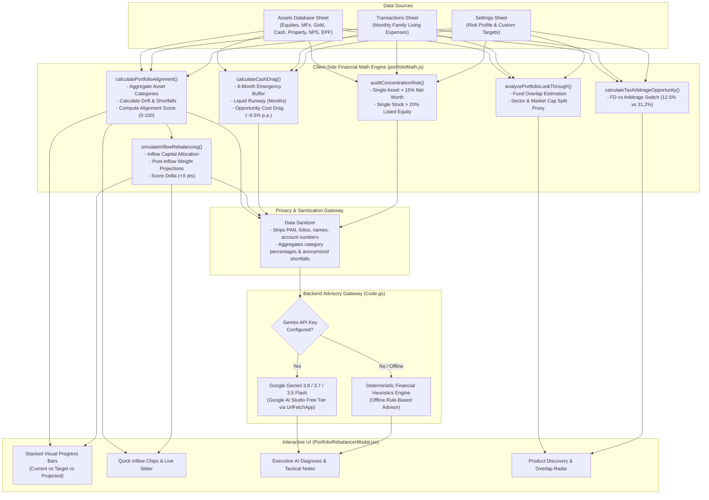
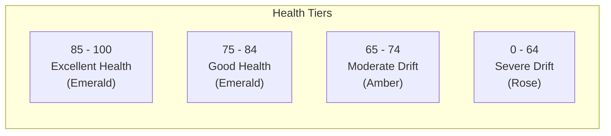
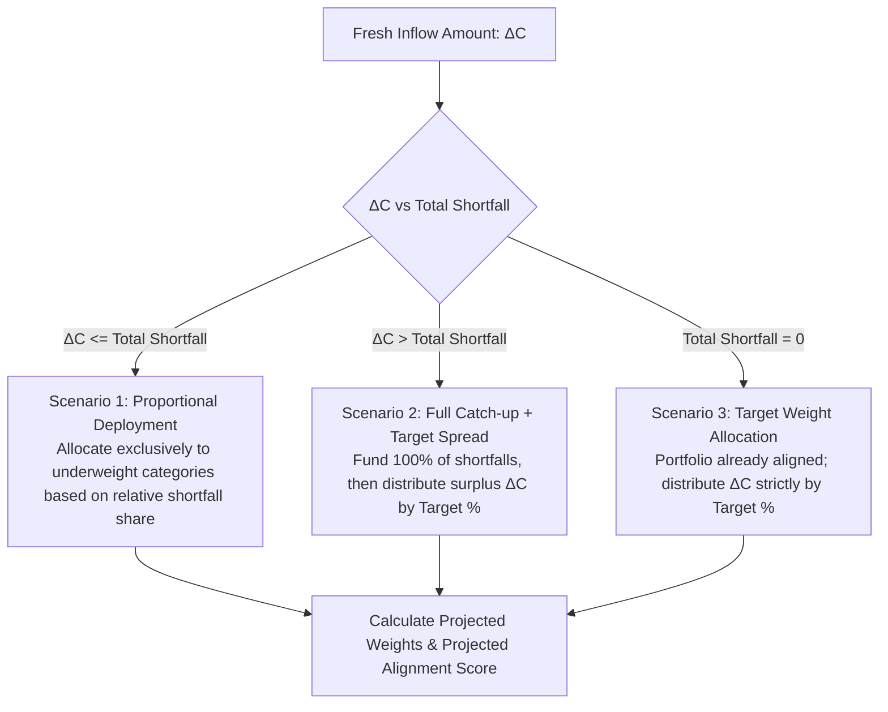
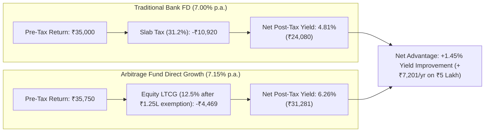
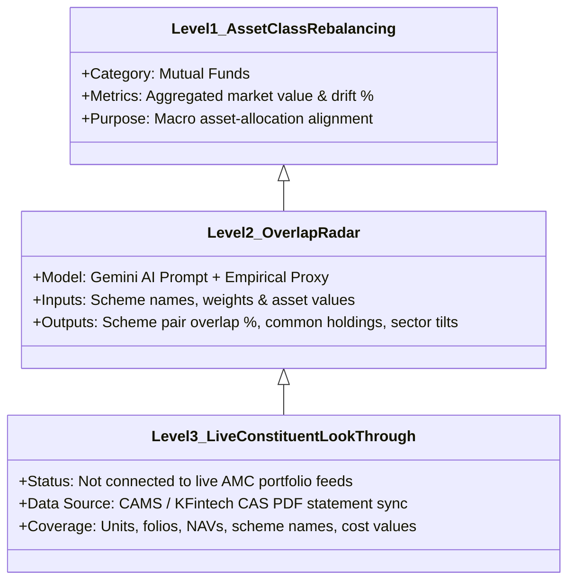
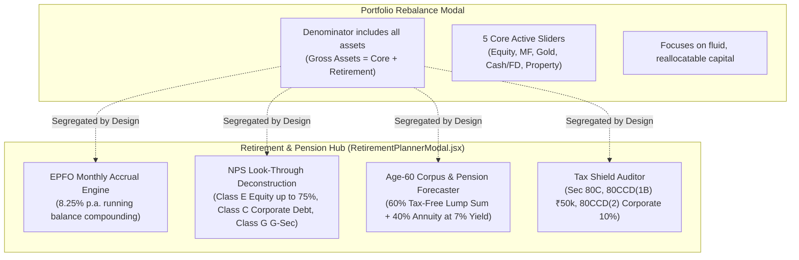

# AI Portfolio Advisor & Rebalance Engine — Comprehensive Guide

> **SEBI Regulatory Notice:** This portfolio rebalancing and product discovery engine provides algorithmic research, financial analytics, and educational simulation tools. It is not personal investment advice or a SEBI-registered advisory service. All investment decisions should be made in consultation with an authorized financial advisor.

---

## 1. Executive Summary & Design Philosophy

The **AI Portfolio Advisor & Rebalance Engine** in Net Worth Manager solves a major dilemma faced by Indian investors: **how to maintain an optimal asset allocation without triggering unnecessary capital gains taxes or interrupting compound growth.**

### The Problem with Traditional Rebalancing in India
Traditional portfolio rebalancing sells overweight assets to purchase underweight ones. In India, selling triggers significant tax liabilities under the Income Tax Act:
- **Section 112A (Long-Term Capital Gains - LTCG):** 12.5% on listed equities and equity mutual funds (beyond the ₹1.25 Lakh annual exemption).
- **Section 111A (Short-Term Capital Gains - STCG):** 20% on equities held for 12 months or less.
- **Debt & Fixed Income:** Taxed at full marginal slab rates (up to 30% + surcharge/cess = **~31.2% - 39%**).

Additionally, selling triggers exit loads, transaction friction, and breaks the multi-year compounding cycle.

### The Solution: "No-Sale Rebalancing" via Smart Fresh Inflows
Net Worth Manager implements an automated **Smart Inflow Rebalancer**:
1. It compares your current asset weights against proven asset-allocation benchmarks.
2. It mathematically calculates the exact rupee shortfall across all underweight categories.
3. Instead of selling overweight positions, it deploys your **incoming savings or fresh capital** (e.g., monthly SIP surpluses, annual bonuses, or liquid reserves) exclusively into underweight assets.
4. Over time, your portfolio naturally drifts back into target alignment **with zero capital gains tax liabilities**.

---

## 2. End-to-End System Architecture

The rebalancing workflow combines deterministic client-side mathematics with an anonymized AI advisory layer powered by Google Gemini (or an offline deterministic heuristics engine).

---

## 3. Mathematical Models & Algorithms

### 3.1 Portfolio Net Worth & Asset Class Categorization

Total gross assets and net worth are computed dynamically across all balance sheet holdings:

$$\text{Gross Assets} = \sum \text{Current Value of all Assets (excluding Liabilities)}$$
$$\text{Net Worth} = \text{Gross Assets} - \sum \text{Liabilities}$$

The standard rebalancer models **5 Core Liquid/Investable Categories**:
1. **Equity** (Direct listed stocks)
2. **Mutual Funds** (Equity, hybrid, index, and debt funds)
3. **Gold** (Physical gold, Sovereign Gold Bonds / SGB, Gold ETFs)
4. **Cash/FD** (Savings bank balances, Fixed Deposits, Recurring Deposits)
5. **Real Estate** (Residential/commercial properties, REITs)

Assets categorized under `Retirement & Pension`, `Provident Funds` (EPF, VPF, PPF, NPS), `Crypto`, or `Other` are classified as `totalOther` in the denominator:
$$\text{Gross Assets} = \sum_{c \in \text{Core}} \text{Value}_c + \text{Value}_{\text{Other}}$$

> [!NOTE]
> For any category $c$, its current weight is:
> $$\text{CurrentPct}_c = \left(\frac{\text{Value}_c}{\text{Gross Assets}}\right) \times 100$$
> If you have a large statutory retirement corpus (EPF/PPF/NPS), your 5 core categories will sum to less than 100% of total wealth. You can adjust your targets in the Customizer to balance these proportions.

---

### 3.2 Target Benchmarks & Alignment Score

#### Pre-Configured Risk Profiles

| Profile Name | Equity | Mutual Funds | Gold | Cash/FD | Real Estate | Target Focus |
| :--- | :---: | :---: | :---: | :---: | :---: | :--- |
| **Moderate (Balanced)** | 35% | 25% | 10% | 15% | 15% | Long-term compounding with balanced hedges |
| **Aggressive (Growth)** | 45% | 25% | 10% | 10% | 10% | High equity tilt for aggressive wealth creation |
| **Conservative (Preservation)** | 15% | 15% | 15% | 35% | 20% | Capital preservation with low volatility |
| **All-Weather (Dalio Hedged)** | 20% | 15% | 15% | 25% | 25% | Multi-regime macroeconomic hedge |
| **Custom** | *User* | *User* | *User* | *User* | *User* | Fully user-defined (must sum to 100%) |

#### Drift & Alignment Score Formula
For each category $c$:
$$\text{DriftPct}_c = \text{CurrentPct}_c - \text{TargetPct}_c$$
- If $\text{DriftPct}_c > +1.5\%$: **Overweight**
- If $\text{DriftPct}_c < -1.5\%$: **Underweight**
- Between $-1.5\%$ and $+1.5\%$: **Aligned**

The **Portfolio Alignment Score (0–100)** measures total systemic deviation:
$$\text{Total Absolute Drift} = \sum_{c \in \text{Target}} |\text{DriftPct}_c|$$
$$\text{Raw Score} = 100 - (\text{Total Absolute Drift} \times 2.5)$$
$$\text{Alignment Score} = \max(0, \min(100, \text{Raw Score}))$$

---

### 3.3 Smart Fresh Inflow Allocation Algorithm

When fresh capital $\Delta C$ is introduced, the engine calculates the post-inflow portfolio size:
$$\text{New Gross Assets} = \text{Gross Assets} + \Delta C$$

For each category $c$, the target rupee value post-inflow is:
$$\text{TargetRupees}_c = \left(\frac{\text{TargetPct}_c}{100}\right) \times \text{New Gross Assets}$$
$$\text{Shortfall}_c = \max(0, \text{TargetRupees}_c - \text{CurrentValue}_c)$$
$$\text{Total Shortfall} = \sum_{c} \text{Shortfall}_c$$

#### Allocation Scenarios:

1. **Scenario 1: Inflow is less than or equal to total shortfall ($\Delta C \le \text{Total Shortfall}$)**
   $$\text{AllocatedRupees}_c = \operatorname{round}\left(\Delta C \times \frac{\text{Shortfall}_c}{\text{Total Shortfall}}\right)$$
   *(Any rounding remainder is automatically credited to the category with the largest shortfall).*

2. **Scenario 2: Inflow exceeds total shortfall ($\Delta C > \text{Total Shortfall}$)**
   $$\text{Surplus} = \Delta C - \text{Total Shortfall}$$
   $$\text{AllocatedRupees}_c = \text{Shortfall}_c + \operatorname{round}\left(\text{Surplus} \times \frac{\text{TargetPct}_c}{100}\right)$$

3. **Scenario 3: Zero Shortfall ($\text{Total Shortfall} = 0$)**
   $$\text{AllocatedRupees}_c = \operatorname{round}\left(\Delta C \times \frac{\text{TargetPct}_c}{100}\right)$$

Post-allocation projections are then re-evaluated:
$$\text{ProjectedPct}_c = \left(\frac{\text{CurrentValue}_c + \text{AllocatedRupees}_c}{\text{New Gross Assets}}\right) \times 100$$
$$\text{Score Improvement} = \max(0, \text{Projected Alignment Score} - \text{Current Alignment Score})$$

---

### 3.4 Cash Drag & Emergency Runway Math

The engine assesses liquidity health using the transaction expense ledger:
1. **Average Monthly Burn ($\bar{E}$):** Computed from the last 12 months of expense transactions ($\bar{E} = \frac{\sum \text{Expenses}}{12}$, with a ₹25,000/mo safety floor).
2. **Liquid Cash ($C_{\text{liquid}}$):** Sum of all assets in `Cash/FD`.
3. **Emergency Runway:**
   $$\text{Runway Months} = \frac{C_{\text{liquid}}}{\bar{E}}$$
4. **Emergency Reserve Target:** A prudential buffer of 6 months of living expenses:
   $$\text{Reserve Target} = \bar{E} \times 6$$
5. **Excess Cash Drag:**
   $$\text{Excess Cash} = \max(0, C_{\text{liquid}} - \text{Reserve Target})$$
6. **Annual Opportunity Cost:**
   $$\text{Annual Drag} \approx \text{Excess Cash} \times 6.5\% \text{ p.a.}$$
   *(Represents the empirical long-term spread between idle savings/short FD rates and a diversified multi-asset portfolio).*

---

### 3.5 Single-Asset & Equity Concentration Audit

The concentration monitor protects against portfolio blowups:
- **Overall Single-Asset Threshold:** Flags any non-real-estate asset whose value constitutes $\ge 15\%$ of total gross assets.
- **Single-Stock Threshold:** Flags any individual stock in the `Equity` category whose value exceeds $\ge 20\%$ of total listed equity assets.

---

## 4. Comprehensive Worked Examples

### Worked Example 1: Moderate Investor with ₹1,00,000 Fresh Capital

#### Baseline Portfolio Snapshot
- Total Gross Assets: **₹20,00,000**
- Liabilities: **₹0** (Net Worth: ₹20,00,000)
- Target Profile: **Moderate (Balanced)**

| Category | Current Value | Current % | Target % | Drift % | Status | Shortfall to Target |
| :--- | :---: | :---: | :---: | :---: | :---: | :---: |
| **Equity** | ₹9,00,000 | 45.0% | 35.0% | +10.0% | **Overweight** | ₹0 |
| **Mutual Funds** | ₹3,00,000 | 15.0% | 25.0% | -10.0% | **Underweight** | ₹2,25,000 |
| **Gold & SGB** | ₹1,00,000 | 5.0% | 10.0% | -5.0% | **Underweight** | ₹1,10,000 |
| **Cash & FD** | ₹4,00,000 | 20.0% | 15.0% | +5.0% | **Overweight** | ₹0 |
| **Real Estate** | ₹3,00,000 | 15.0% | 15.0% | 0.0% | **Aligned** | ₹15,000 |
| **Total** | **₹20,00,000** | **100.0%** | **100.0%** | $\sum |\text{Drift}| = 30.0\%$ | — | $\sum \text{Shortfall} = ₹3,50,000$ |

#### Alignment Score Calculation (Current):
$$\text{Total Absolute Drift} = |+10.0| + |-10.0| + |-5.0| + |+5.0| + |0.0| = 30.0\%$$
$$\text{Raw Score} = 100 - (30.0 \times 2.5) = 100 - 75 = \mathbf{25/100} \text{ (Severe Drift)}$$

---

#### Simulating Fresh Inflow of ₹1,00,000:
- New Gross Assets = $₹20,00,000 + ₹1,00,000 = \mathbf{₹21,00,000}$
- Inflow ($₹1,00,000$) is less than total shortfall ($₹3,50,000$).
- Underweight Categories share the inflow proportionally:
  - **Mutual Funds Shortfall:** ₹2,25,000 (Share: $2,25,000 / 3,50,000 = 64.28\%$)
    $$\text{Allocation} = ₹1,00,000 \times 64.28\% = \mathbf{₹64,286}$$
  - **Gold Shortfall:** ₹1,10,000 (Share: $1,10,000 / 3,50,000 = 31.43\%$)
    $$\text{Allocation} = ₹1,00,000 \times 31.43\% = \mathbf{₹31,429}$$
  - **Real Estate Shortfall:** ₹15,000 (Share: $15,000 / 3,50,000 = 4.29\%$)
    $$\text{Allocation} = ₹1,00,000 \times 4.29\% = \mathbf{₹4,285}$$

#### Post-Inflow Projected Portfolio:

| Category | Pre-Inflow | Fresh Inflow | Post-Inflow Value | Projected % | Target % | Projected Drift |
| :--- | :---: | :---: | :---: | :---: | :---: | :---: |
| **Equity** | ₹9,00,000 | ₹0 | ₹9,00,000 | 42.8% | 35.0% | +7.8% |
| **Mutual Funds** | ₹3,00,000 | +₹64,286 | ₹3,64,286 | 17.3% | 25.0% | -7.7% |
| **Gold & SGB** | ₹1,00,000 | +₹31,429 | ₹1,31,429 | 6.3% | 10.0% | -3.7% |
| **Cash & FD** | ₹4,00,000 | ₹0 | ₹4,00,000 | 19.0% | 15.0% | +4.0% |
| **Real Estate** | ₹3,00,000 | +₹4,285 | ₹3,04,285 | 14.5% | 15.0% | -0.5% |
| **Total** | **₹20,00,000** | **+₹1,00,000** | **₹21,00,000** | **100.0%** | **100.0%** | $\sum |\text{Drift}| = 23.7\%$ |

#### Projected Alignment Score:
$$\text{Projected Drift} = 7.8 + 7.7 + 3.7 + 4.0 + 0.5 = 23.7\%$$
$$\text{Projected Score} = 100 - (23.7 \times 2.5) = 100 - 59.25 = \mathbf{41/100}$$
$$\mathbf{\text{Score Improvement}} = 41 - 25 = \mathbf{+16 \text{ points without selling any shares!}}$$

**Tax Saved:** By adding fresh capital instead of selling ₹1,65,000 worth of overweight Equities and Cash, the investor avoids triggering up to ₹20,625 in Section 112A/111A capital gains tax and keeps the entire capital compounding.

---

### Worked Example 2: Emergency Runway & Cash Drag Audit

- Bank Accounts + FDs (`Cash/FD`): **₹8,50,000**
- Monthly Family Living Expenses: **₹65,000/month**
- **Runway:** $\frac{₹8,50,000}{₹65,000} = \mathbf{13.1 \text{ months}}$
- **6-Month Emergency Buffer Target:** $₹65,000 \times 6 = \mathbf{₹3,90,000}$
- **Excess Cash Drag:** $₹8,50,000 - ₹3,90,000 = \mathbf{₹4,60,000}$
- **Annual Opportunity Cost:**
  $$\text{Opportunity Cost} = ₹4,60,000 \times 6.5\% = \mathbf{₹29,900/\text{year}}$$
- **Engine Recommendation:** Keep ₹3.90 Lakh in liquid savings/sweep FDs for immediate emergencies. Channel the remaining ₹4.60 Lakh into underweight asset categories or high-yielding Arbitrage Funds.

---

### Worked Example 3: Tax Arbitrage Switch (Fixed Deposit vs Arbitrage Fund)

For an investor in the **30% income tax bracket** (31.2% effective rate with 4% Health & Education cess) with ₹5,00,000 in surplus cash:

---

## 5. Mutual Fund Look-Through, Overlap Radar & Asset Classes

### 5.1 Three Levels of Mutual Fund Evaluation

1. **Level 1: Broad Asset Class Rebalancing**
   - All equity, hybrid, and debt mutual funds are grouped under `Mutual Funds` to maintain your macro risk benchmark.
2. **Level 2: AI Overlap Radar & Sector Skew**
   - Evaluates scheme names to detect portfolio duplication (e.g., holding both a *Flexi Cap Fund* and a *Nifty 50 Index Fund* often results in 40–55% portfolio duplication across top bluechip holdings: HDFC Bank, ICICI Bank, Reliance Industries, Infosys, and TCS).
   - Models sector tilts (Financials ~38.4%, Tech ~21.2%, Auto ~14.1%, FMCG ~11.0%, Healthcare ~8.5%) and market-cap distribution (Large Cap 68%, Mid Cap 22%, Small Cap 10%).
3. **Level 3: Constituent Stock Look-Through (Scope Boundary)**
   - The app **does not** query real-time 100-security AMC factsheet disclosures via external paid feeds.
   - It relies on your **CAS (Consolidated Account Statement) PDF Parser** (`casParser.js`) to extract accurate folios, units, purchase costs, and market valuations, and then applies **Gemini AI reasoning** to evaluate inter-scheme overlap.

---

### 5.2 Curated Direct Product Recommendations

To help users deploy fresh money without duplicating existing exposure, the engine suggests low-cost direct instruments:

| Product Class | Curated Instrument | Expense Ratio (TER) | Unique Strategic Value | Tax Treatment |
| :--- | :--- | :---: | :--- | :--- |
| **Emerging Equities** | UTI / ICICI Nifty Next 50 Direct Index | 0.22% | 0% overlap with Nifty 50; introduces mid-to-large champions | 12.5% LTCG |
| **Sovereign Gold** | SGB (2031–32 Series) Secondary Market | 0.00% | Purchased at ~3.1% discount to spot; zero 3% GST | **100% Tax-Free** at maturity + 2.5% coupon |
| **Cash / Liquid** | Tata / Kotak Arbitrage Fund Direct Growth | 0.34% | Risk-free cash-futures spread with equity capital gains taxation | 12.5% LTCG vs 31.2% FD rate |
| **Multi-Asset** | ICICI Prudential Multi-Asset Direct Growth | 0.62% | Automated dynamic rebalancing between Equity, Debt, and Gold | Equity taxation status |

---

## 6. How Retirement Savings (EPF, PPF, NPS) Fit In

### Why Are Retirement Savings Handled Separately?

Statutory Indian retirement savings have unique operational characteristics:
- **Lock-in Periods:** EPF is locked until retirement/employment separation; PPF has a 15-year tenure; NPS is locked until age 60.
- **Inflexible Liquidity:** You cannot liquidate or trim EPF or NPS to buy stocks or gold during a monthly rebalance.
- **Automated Inflows:** Contributions are usually automated via employer payroll deductions.

### Where Retirement Savings Are Handled:

---

## 7. Privacy, Security & AI Governance

1. **Zero Personally Identifiable Information (PII) Transmitted:**
   Before calling Google Gemini, the backend sanitizes the payload:
   - Account numbers, folios, names, and transaction remarks are stripped.
   - Only category-level aggregate numbers, drift percentages, and concentration ratios are transmitted.
2. **Dual-Engine Architecture:**
   - **Google Gemini Flash (Free Tier):** If an API key is configured (stored securely in your private Google Sheet `Settings` tab), Gemini Flash models produce conversational tactical analysis.
   - **Offline Deterministic Fallback:** If no API key is set, the app runs a built-in rule-based heuristics engine in Google Apps Script, ensuring the system remains fully functional without any external API dependencies.
3. **Client-Side Verification:**
   All rebalance simulations run locally in your browser memory before anything is written to your Google Sheet.

---

## 8. Summary Comparison Matrix

| Feature | In Net Worth Manager? | Technical Implementation |
| :--- | :---: | :--- |
| **Automated Drift & Alignment Scoring** | ✅ Yes | `calculatePortfolioAlignment()` in `portfolioMath.js` (Formula: $100 - (\text{Drift} \times 2.5)$) |
| **No-Sale Fresh Inflow Rebalancer** | ✅ Yes | `simulateInflowRebalancing()` with proportional shortfall allocations |
| **Capital Gains Tax Optimization** | ✅ Yes | Avoids Section 112A/111A liabilities by rebalancing strictly via fresh capital |
| **Emergency Buffer & Cash Drag** | ✅ Yes | 6-month living expense runway evaluation in `calculateCashDrag()` |
| **Concentration Risk Monitor** | ✅ Yes | Single-asset $>15\%$ and single-stock $>20\%$ alerts in `auditConcentrationRisk()` |
| **Retirement (EPF/PPF/NPS) in Net Worth** | ✅ Yes | Included in `totalGrossAssets` and `netWorth`; detailed sub-ledger in Retirement Hub |
| **Mutual Fund Scheme Overlap Radar** | ✅ Yes | Gemini AI prompt + heuristic bluechip overlap in `analyzePortfolioLookThrough()` |
| **Live AMC Factsheet Stock Scraper** | ❌ No | Replaced by CAS statement parsing + Gemini AI heuristic look-through |
| **Direct Product Recommendations** | ✅ Yes | Non-sponsored, zero-commission curated funds (Index, SGB, Arbitrage, Multi-Asset) |
