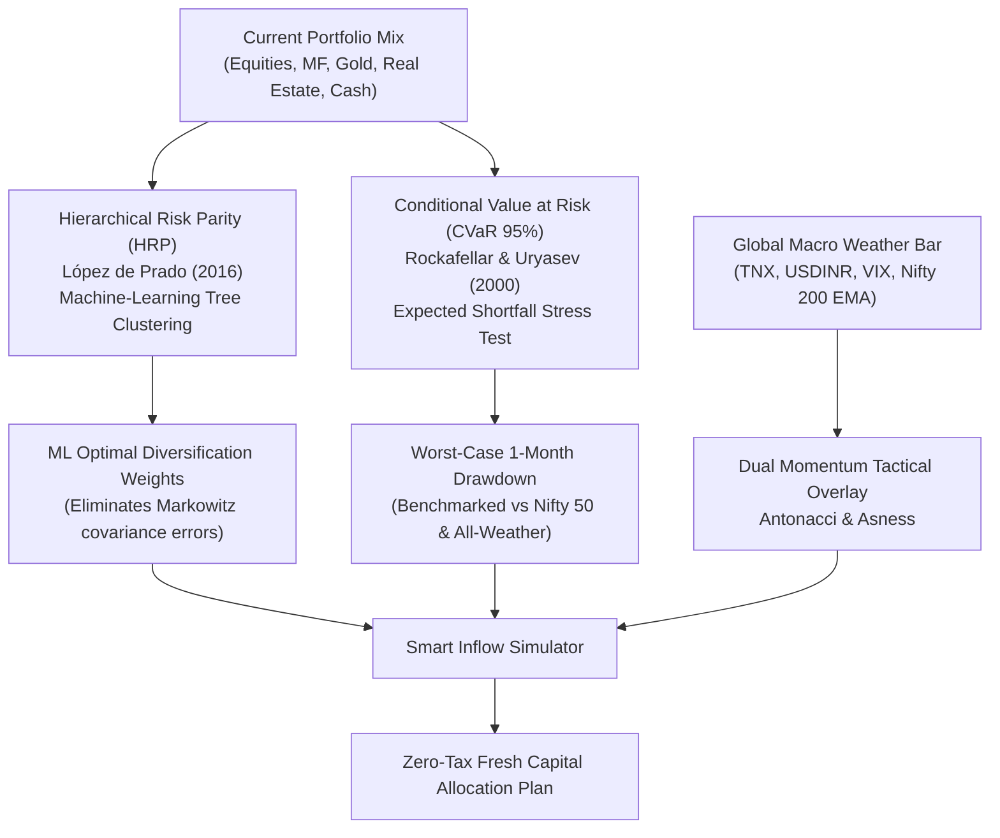

# Net Worth Manager — Portfolio Metrics, Quantitative Stats & Investor Guide

A comprehensive, plain-English reference manual for deciphering every statistical metric, quantitative formula, stress test, and macroeconomic indicator in Net Worth Manager — complete with actionable playbooks to protect and grow personal wealth.

An interactive, responsive HTML version of this guide is available at [PORTFOLIO_METRICS_AND_TERMINOLOGY_GUIDE.html](file:///sdcard/Projects/nozelrosario/net-worth-manager/docs/PORTFOLIO_METRICS_AND_TERMINOLOGY_GUIDE.html).

---

## 1. Core Portfolio Health & Drift Metrics

### 1.1 Portfolio Alignment Score (0% – 100%)
- **What it is:** Measures the mathematical similarity between your current asset weights and your targeted financial risk profile (Moderate, Aggressive, Conservative, All-Weather, or Custom).
- **Mathematical Formula:**
  $$\text{Alignment Score} = 100 - \left( 0.5 \times \sum_{i \in \text{Categories}} |\text{Current Weight}_i - \text{Target Weight}_i| \right)$$
- **Score Ranges & Interpretation:**
  - **90% – 100% (Optimal):** Your portfolio is humming smoothly. No rebalancing needed.
  - **75% – 89% (Moderate Drift):** Minor deviation. Ideal candidate for fresh capital inflow rebalancing.
  - **< 75% (High Drift):** Substantial deviation from your intended risk profile.
- **Investor Playbook:** Do **not** sell assets to fix drift. Selling triggers 12.5% Long-Term Capital Gains (LTCG) tax, STCG tax, exit loads, and brokerage fees. Instead, use the **Inflow Rebalance Simulator** to direct upcoming monthly SIPs and bonuses into underweighted buckets until your score returns to >90%.

---

### 1.2 Category Drift ($\Delta\%$)
- **What it is:** The percentage point difference between your actual holdings and your target allocation.
- **Example:** If your target for Equities is **50%**, but a strong bull market has expanded your equities to **62%**, your drift is **+12.0% (Overweight)**. If Gold is at **5%** vs. a **15%** target, your drift is **-10.0% (Underweight)**.
- **Investor Playbook:** Negative drift flags where your portfolio is defensively starved. Target fresh savings toward negative drift categories to purchase valuable assets at relatively lower valuations.

---

### 1.3 Cash Drag (₹ and %)
- **What it is:** The estimated annual return penalty caused by keeping excess idle cash in low-yielding savings bank accounts (2.7%–3.5%) instead of inflation-beating productive assets.
- **Formula:**
  $$\text{Cash Drag} = (\text{Current Cash} - \text{Recommended 6–12M Buffer}) \times (\text{Expected Portfolio Return} - 3.0\%)$$
- **Real-World Impact:** Having ₹10,00,000 sitting idle beyond emergency requirements incurs a drag of **₹70,000 to ₹90,000 every single year** against retail inflation.
- **Investor Playbook:** Maintain 6 to 12 months of living expenses in an Emergency Liquid Fund. Move the rest into Target Maturity Funds (TMFs) locking in ~7.4% sovereign yields or Arbitrage Funds (yielding ~7.0% with equity tax status).

---

### 1.4 Emergency Runway (Months)
- **What it is:** The number of months your household can sustain its current lifestyle with zero incoming revenue, relying solely on liquid bank accounts and emergency deposits.
- **Formula:**
  $$\text{Emergency Runway} = \frac{\text{Liquid Bank Balance + Liquid Funds}}{\text{Average Monthly Spends}}$$
- **Prudential Standards:**
  - **Salaried Professionals:** 6 to 9 Months.
  - **Business Owners / Freelancers:** 12 to 18 Months.
  - **Below 3 Months:** Vulnerable. Pause aggressive equity lump sums until liquid savings are restored.

---

## 2. Global Macro Weather & Market Regimes

The **Global Macro Weather Bar** continuously evaluates 6 native Google Finance streaming tickers to detect macroeconomic tailwinds and headwinds.

| Indicator | Symbol | Role | Bullish / Supportive Zone | Stress / Panic Zone |
| :--- | :--- | :--- | :--- | :--- |
| **US 10Y Yield** | `INDEXCBOE:TNX` | Global Risk-Free Hurdle Rate | < 4.00% | > 4.50% (triggers FII outflows from India) |
| **USD / INR** | `CURRENCY:USDINR` | Exchange Rate Health | Stable / gradual 3% drift | Rapid spikes > ₹84.50+ (FII flight to safety) |
| **India VIX** | `INDEXNSE:INDIAVIX` | Domestic Market Fear Gauge | 12.0 – 16.0 (Normal) | > 22.0 (Extreme fear / capitulation) |
| **Nifty 50 Trend** | `INDEXNSE:NIFTY_50` | 200 EMA Trend Filter | CMP > 200 EMA (Structural Bull) | CMP < 200 EMA (Structural Bear / Correction) |
| **Silver Spot INR** | `CURRENCY:XAGINR` | Gold/Silver Relative Value | Ratio < 80 (Economic expansion) | Ratio > 90 (Defensive flight to precious metals) |
| **Brent Crude Oil** | `COMMODITY:BRENT_CRUDE` | Imported Inflation Proxy | < $75 / barrel | > $85 / barrel (expands current account deficit) |

### The 4 Macro Regimes:
1. **Risk-On (Score 70–100):** Low volatility, supportive currency, yields easing. Favorable for aggressive equity expansion and SIP step-ups.
2. **Neutral / Balanced (Score 40–69):** Steady-state economic backdrop. Follow strategic baseline asset weights.
3. **Risk-Off / Caution (Score < 40):** Elevated yields, currency pressure, spiking VIX. Withhold lump-sum equity deployment; direct fresh capital into Sovereign Gold Bonds and TMFs.
4. **Stagflation Alert:** Brent crude > $85 + rising yields + sluggish growth. Overweight Gold, commodities, and short-duration fixed income.

---

## 3. Quantitative Optimization & Downside Tail-Risk Stress Testing

### 3.1 Machine Learning Hierarchical Risk Parity (HRP)
- **Origin:** Marcos López de Prado (2016), Lawrence Berkeley National Laboratory.
- **Why Traditional Markowitz Mean-Variance Fails:** Standard optimization requires inverting a covariance matrix. In Indian portfolios where mutual funds hold overlapping stocks, this causes extreme mathematical instability, generating unrealistic or hyper-concentrated weights.
- **How HRP Works:**
  1. Computes correlation distance metric: $d_{i,j} = \sqrt{\frac{1 - \rho_{i,j}}{2}}$.
  2. Constructs a hierarchical tree dendrogram clustering similar assets together.
  3. Uses quasi-diagonalization and recursive bisection to allocate weights inversely proportional to risk cluster variance.
- **How to Use:** In the Portfolio Rebalancer, select the **🧠 ML HRP** preset to compare your holdings against mathematically optimal multi-asset parity.

---

### 3.2 Conditional Value at Risk (CVaR at 95%) / Expected Shortfall
- **Origin:** Rockafellar & Uryasev (2000).
- **Why Standard Deviation is Inadequate:** Standard deviation penalizes upside gains (stocks going up 50%) exactly the same as downside crashes (stocks dropping 50%).
- **What CVaR Quantifies:** The average expected loss during the worst 5% of monthly market shocks (e.g., 2008 Lehman crisis, March 2020 COVID crash).
- **Comparative Benchmarks:**
  - **Nifty 50 Index (Pure Equity):** Typical 1-Month Worst-Case Downside: **-18.4%**.
  - **Diversified Portfolio:** Typical Downside: **-8.5% to -11.5%**.
  - **All-Weather Defensive:** Typical Downside: **-5.8%**.
- **Diversification Ratio ($DR$):**
  $$DR = \frac{\sum w_i \sigma_i}{\sigma_{\text{portfolio}}}$$
  A $DR > 1.4\times$ confirms institutional-level risk insulation, showing that non-correlated assets (Gold, Sovereign Debt) are absorbing market shocks.

---

### 3.3 Dual Momentum & Tactical Inflow Multipliers
- **Origin:** Gary Antonacci (2014) and Cliff Asness (AQR Capital).
- **The Engine:**
  - **Strategic Baseline:** Allocates fresh savings strictly in proportion to current underweight gaps.
  - **Tactical Macro Overlay:** Multiplies allocation tranches by trend and macro health:
    - **1.25x Multiplier:** Asset is underweight **and** confirming a positive structural trend above its 200 EMA.
    - **0.50x Multiplier:** Asset is experiencing a macro breakdown (trading below 200 EMA in high-VIX panic). Fresh capital is slowed down, with remaining tranches routed into safe liquid buffers until the trend stabilizes.

---

## 4. Modern Indian Investment Vehicles & Yield Alpha

Traditional Indian portfolios rely excessively on low-yielding Bank FDs and illiquid, tenant-heavy physical real estate. Net Worth Manager expands core asset classes into 4 institutional vehicles:

| Modern Instrument | Vehicle Type | Typical Return / Yield | Taxation | Strategic Role in Portfolio |
| :--- | :--- | :---: | :--- | :--- |
| **Target Maturity Debt Funds (TMFs)** | Passive G-Sec / SDL Index Fund | **7.25% – 7.50% locked YTM** | Slab rate at redemption | Replaces Bank FDs. Zero credit default risk; roll-down duration eliminates interest-rate risk. |
| **REITs & InvITs** | Commercial Office / Mall Trust | **6.8% – 8.2% cash distribution** | Dividends & debt repayments partially Sec 10(23FD) exempt | Replaces physical real estate with liquid, publicly traded commercial Grade-A assets. |
| **Secondary SGB Arbitrage** | Sovereign Gold Bonds on NSE/BSE | **Spot Gold + 2.5% coupon** | **100% Tax-Free capital gains** | Bought at 2.0%–4.5% discount to spot gold with zero GST. |
| **Factor / Smart Beta ETFs** | Momentum 30, Alpha Low-Vol 30 | **16% – 21% historical 5Y CAGR** | 12.5% LTCG, 20% STCG | Delivers rule-based factor alpha with ultra-low TER (0.22%–0.30%) vs active funds (1.80%). |

---

## 5. Frequently Asked Questions

### Q1: Why doesn't the app tell me to sell overweighted stocks?
**Answer:** Selling profitable assets triggers 12.5% LTCG tax, brokerage, and exit loads, while cutting off long-term compounders. Net Worth Manager practices **Zero-Sale Rebalancing**: all portfolio alignment is achieved by tactically routing upcoming savings into underweighted buckets.

### Q2: How often should I check my portfolio health and macro weather?
**Answer:** Review the **Global Macro Weather Bar once a week** for macro awareness, and run the **Portfolio Rebalancer once a month** when deploying your monthly savings or SIP tranches.

### Q3: What is the single most important number on the dashboard?
**Answer:** The **Portfolio Alignment Score**. Keeping your alignment score above 85%–90% ensures that your wealth compounding matches your risk tolerance across market cycles.
